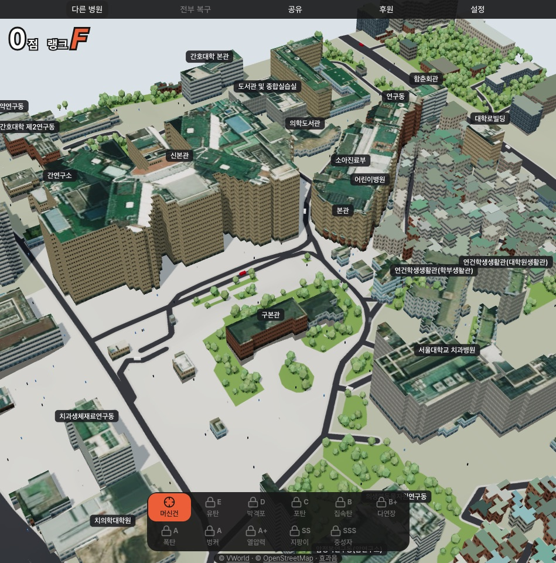
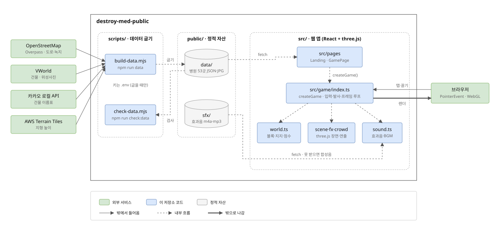
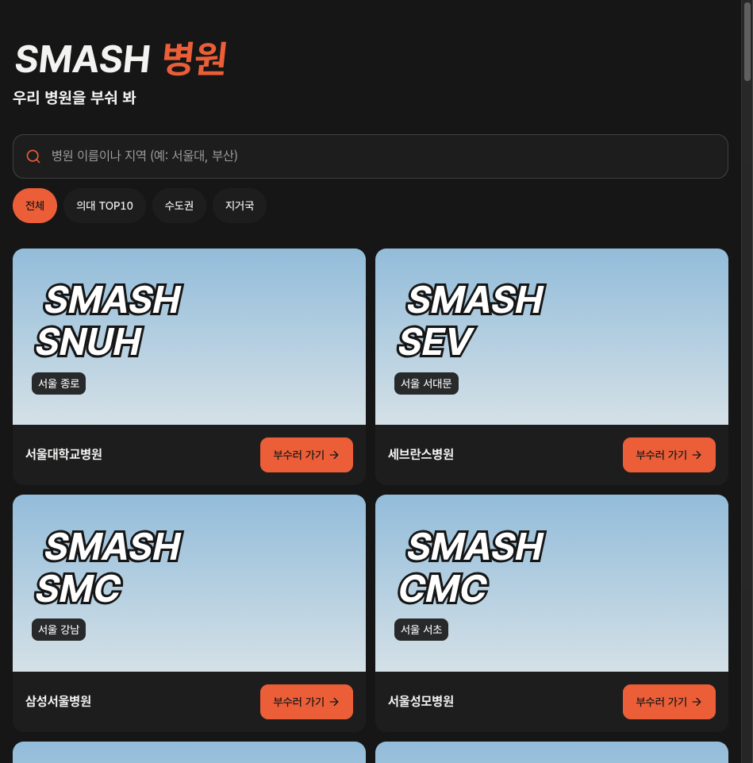

# SMASH 병원
실제 대학병원 캠퍼스를 3D로 불러와 무기로 부수는 브라우저 게임

> 현행 기준: 2026-11-04 · 애플리케이션 버전 0.55.5



# 개요

SMASH 병원은 국내 대학병원 53곳의 실제 건물 배치를 3D 블록으로 만들고, 그 건물을 무기로 무너뜨리는 웹 게임입니다.

**우리 병원을 부숴 봐.**

- 건물 모양과 높이는 공공 건물 데이터에서, 도로와 녹지는 OpenStreetMap에서, 옥상은 위성사진에서 가져옵니다.
- 밑동을 부수면 위층이 받침을 잃고 떨어집니다. 블록마다 지지 여부를 다시 계산하기 때문입니다.
- 점수가 오르면 랭크가 오르고, 랭크마다 더 센 무기가 열립니다.
- 설치 없이 브라우저에서 돌고, PC 마우스와 휴대폰 터치를 같은 조작으로 받습니다.

# 설치 및 실행 방법

### 전제조건

- Node.js `^20.19.0` 또는 `>=22.12.0` (Vite 8이 요구하는 버전입니다)
- npm (저장소에 `package-lock.json`이 있습니다)

### 설치

```bash
npm ci
```

### 실행

```bash
npm run dev
```

터미널에 뜨는 주소(기본 `http://localhost:5173`)를 브라우저로 엽니다.

### 빌드와 검사

```bash
npm run build
```

```bash
npm run check:engine
```

```bash
npm run check:data
```

| 명령 | 하는 일 |
|---|---|
| `npm run build` | 타입 검사 뒤 `dist/`에 정적 파일을 만듭니다 |
| `npm run check:engine` | 블록 생성·피해·붕괴·되돌리기 로직을 assert로 확인합니다 |
| `npm run check:data` | `public/data`의 JSON이 장면 스키마를 지키는지 확인합니다 |
| `npm run lint` | oxlint로 코드를 검사합니다 |

### 환경변수

게임을 돌리는 데는 환경변수가 필요 없습니다. 장면 데이터는 `public/data`에 이미 구워져 있습니다.

병원 데이터를 다시 구울 때(`npm run data`)만 프로젝트 루트 `.env`에 키를 넣습니다.

| 변수명 | 필수 | 기본값 | 설명 |
|---|---|---|---|
| `VWORLD_KEY` | 데이터 굽기 때 | 없음 | 건물·위성사진. [VWorld 오픈API](https://www.vworld.kr)에서 발급 |
| `KAKAO_REST_API_KEY` | 선택 | 없음 | 건물 이름표. [Kakao Developers](https://developers.kakao.com)에서 발급. 없으면 이름표를 건너뜁니다 |

# 주요 기능

### 실제 병원 53곳
병원 목록은 `scripts/hospitals.mjs`가 정본입니다.  
`npm run data`가 OSM·VWorld·카카오·AWS Terrain Tiles에서 건물, 도로, 녹지, 지형 높이, 옥상 사진을 받아 병원마다 JSON 한 개로 굽습니다.  
게임은 실행 중에 외부 지도 API를 부르지 않고 이 JSON만 읽습니다.

### 무기 11종과 랭크 해금
머신건부터 중성자탄까지 11종이 `src/game/weapons.ts`에 있습니다.  
처음에는 머신건만 열려 있고, 점수로 랭크(F → SSS)가 오를 때마다 다음 무기가 풀립니다.

### 블록 단위 붕괴
건물은 층과 칸으로 나눈 블록으로 이루어집니다.  
`src/game/world.ts`가 맞은 블록의 피해를 매기고, 땅까지 이어진 블록을 다시 찾아 받침 잃은 부분을 떨어뜨립니다.  
렌더링과 분리된 순수 로직이라 `npm run check:engine`으로 브라우저 없이 확인합니다.

### 대피하는 사람과 차
공격이 시작되면 병원 출입구에서 사람과 차가 빠져나와 도로로 흩어집니다(`src/game/crowd.ts`).

### 효과음과 대체 합성음
무기마다 효과음이 있습니다. `.m4a`를 먼저 받고, 못 열면 `.mp3`, 그것도 안 되면 WebAudio 합성음을 냅니다.  
그래서 음원 파일이 빠져도 게임은 멈추지 않습니다.

### 점수 카드 공유
게임 화면의 공유 버튼이 병원 이름, 점수, 랭크를 넣은 카드 이미지를 만들고 X·페이스북 공유 주소를 엽니다(`src/lib/share.ts`).

### PC와 휴대폰 같은 조작
탭하면 발사, 길게 누르면 연사, 한 손가락으로 끌면 회전, 두 손가락으로 확대·이동합니다.  
입력은 `PointerEvent` 하나로 받아 마우스와 터치를 같은 코드가 처리합니다.

# 시스템 구조

```text
scripts/build-data.mjs (데이터 굽기, 개발자 PC에서만)
  <- OpenStreetMap · VWorld · 카카오 로컬 · AWS Terrain Tiles
  -> public/data/*.json, public/data/roof/*.jpg

Browser
  -> src/pages (Landing: 병원 목록 / GamePage: HUD)
       -> fetch public/data
       -> src/game/index.ts createGame
            -> world.ts (블록·지지·점수)
            -> scene.ts · fx.ts · crowd.ts (three.js 장면·연출)
            -> sound.ts -> fetch public/sfx
```

| 구성 요소 | 책임 |
|---|---|
| `src/pages` | 랜딩(병원 검색·목록)과 게임 화면 HUD(무기 바, 점수, 알림, 공유) |
| `src/game` | 파괴 엔진. `index.ts`가 입력·발사·프레임 루프를 묶고 `world.ts`가 상태를 갖습니다 |
| `src/lib` | 병원 목록 로드, 주소 라우팅, 공유 카드, 에러 문구 |
| `src/components` | 공유·후원 대화상자, `ui/` 아래 공용 UI 부품 |
| `public/data` | 구워 둔 병원별 장면 JSON과 옥상 사진 |
| `public/sfx` | 효과음 음원과 출처 표기(`CREDITS.md`) |
| `scripts` | 장면 데이터 굽기(`build-data.mjs`)와 스키마 검사(`check-data.mjs`) |



- 왼쪽 초록 상자는 데이터를 굽는 순간에만 쓰는 외부 서비스입니다. 키도 그때만 필요합니다.
- 구운 결과는 가운데 `public/`에 정적 파일로 남고, 게임은 이 파일만 받아 씁니다.
- `src/game/index.ts`가 브라우저의 포인터 입력을 받아 `world.ts` 상태를 바꾸고, three.js 장면으로 그려 돌려줍니다.
- 배포는 정적 호스팅 하나면 됩니다. `vercel.json`은 `/h/:id` 주소를 `index.html`로 돌려보내는 설정입니다.

# 현재 계약

- 게임 로직의 정본은 `src/game/` 한 벌입니다. PC와 모바일은 입력 방식과 화면 배치만 다르고, 모바일용 로직 사본을 두지 않습니다.
- 입력의 정본은 `PointerEvent`입니다. `mousedown`·`mouseup` 같은 마우스 전용 이벤트를 쓰지 않습니다.
- 모든 기능은 HUD 버튼으로 됩니다. 키보드 단축키나 hover로만 되는 기능을 두지 않습니다.
- 장면의 정본은 `public/data`의 구운 JSON입니다. 게임 실행 중에 지도 API를 직접 부르지 않습니다.
- 무기 칸 밑 설명은 공백 포함 10자 이하입니다. `npm run check:engine`이 검사합니다.
- 화면의 VWorld·OpenStreetMap 출처 표기는 지우지 않습니다. OSM 데이터는 ODbL 조건으로 씁니다.

# 화면 및 메뉴 구성



랜딩(`/`)에서 병원 이름이나 지역으로 검색하고, 의대 TOP10·수도권·지거국으로 걸러 부술 병원을 고릅니다.


게임(`/h/:id`)에서 아래 무기 바로 무기를 고르고 건물을 눌러 쏩니다. 위 메뉴는 다른 병원 · 전부 복구 · 공유 · 후원 · 설정입니다.

# 문서 안내

| 문서 | 기준 범위 |
|---|---|
| [public/sfx/CREDITS.md](public/sfx/CREDITS.md) | 효과음·음악 출처와 라이선스 |
| [scripts/hospitals.mjs](scripts/hospitals.mjs) | 수록 병원 목록과 좌표 |
| [src/game/types.ts](src/game/types.ts) | 장면 데이터 스키마와 엔진 공개 타입 |

# 데이터와 음원 출처

- 건물: [VWorld](https://www.vworld.kr) 건물통합정보, 위성사진
- 도로·녹지: © [OpenStreetMap](https://www.openstreetmap.org/copyright) contributors, ODbL
- 지형: AWS Terrain Tiles
- 효과음: [public/sfx/CREDITS.md](public/sfx/CREDITS.md). CC BY-NC 음원이 섞여 있어 상업적으로 쓸 수 없습니다.
- 배경음악 파일(`public/sfx/bgm.m4a`)은 이 저장소에 없습니다. 없으면 배경음악 없이 효과음만 납니다.
